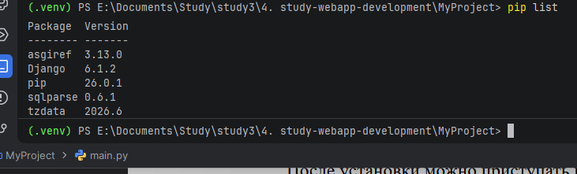
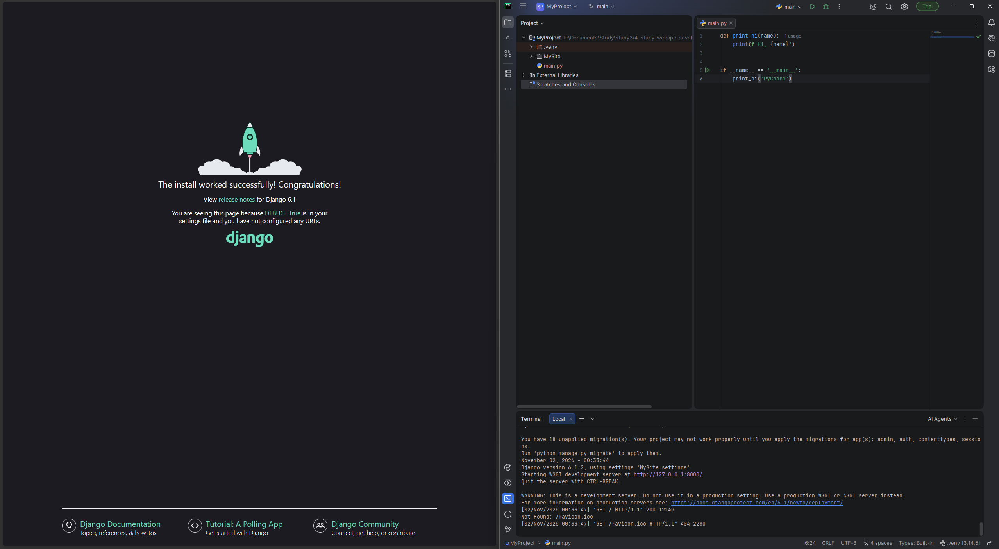
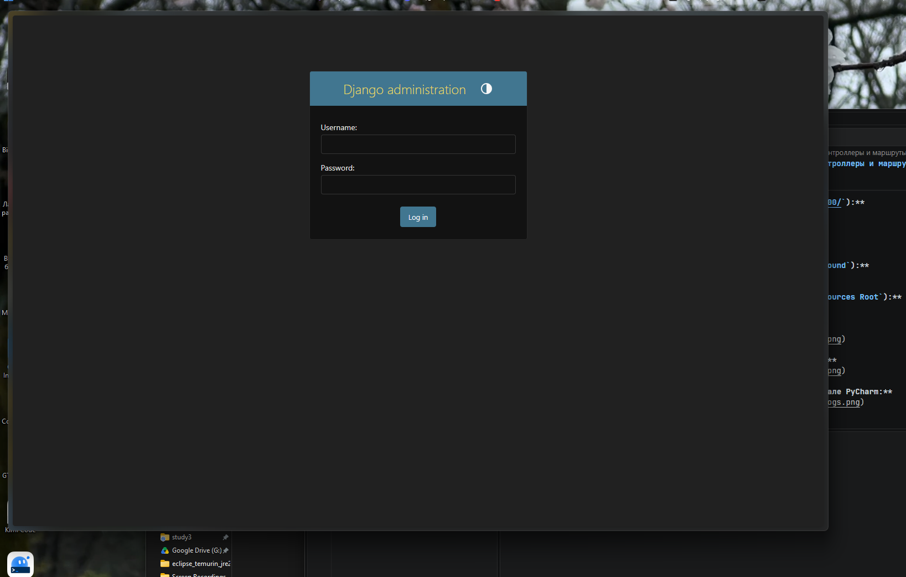
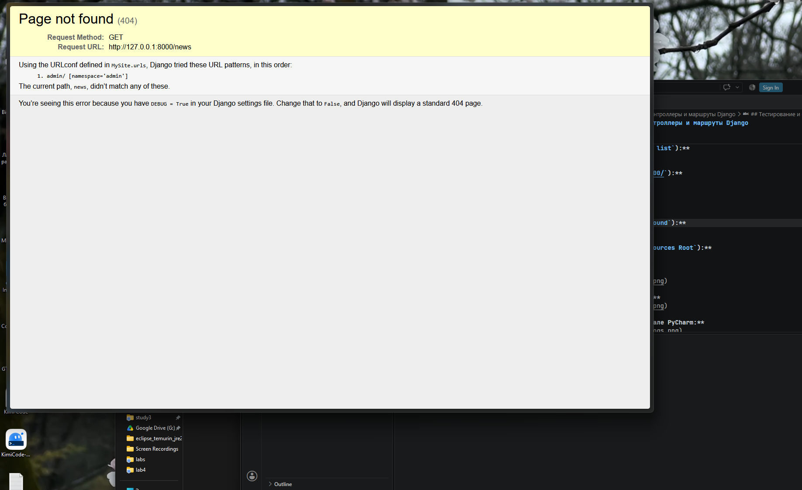
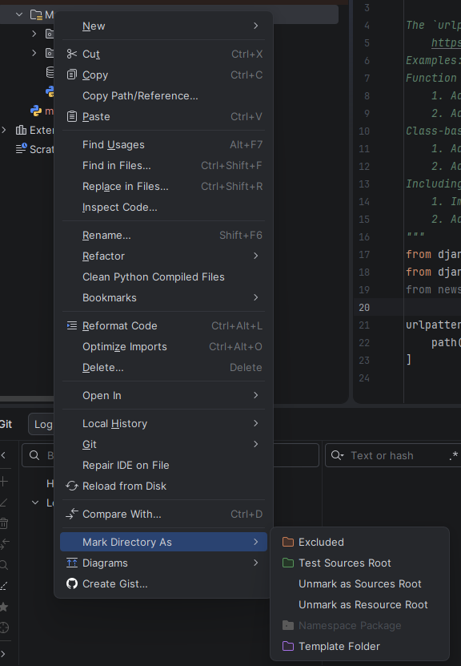
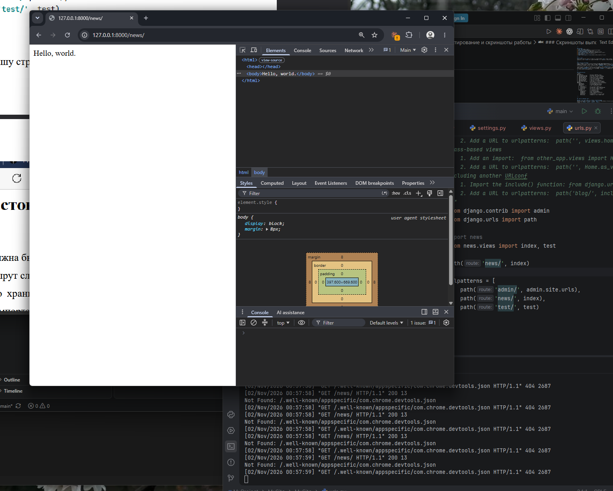
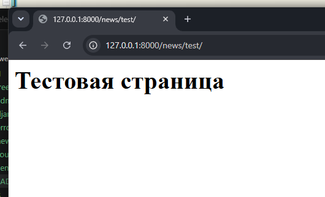
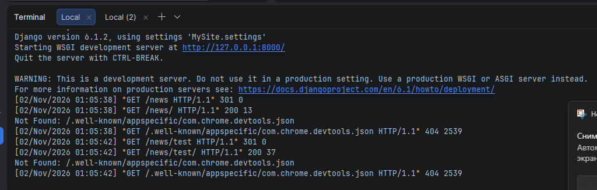

# Лабораторная работа №1: Создание виртуального окружения. Контроллеры и маршруты Django

**Дисциплина:** Разработка web-приложений  
**Студент:** Гаджиев Магомед Исламович  
**Группа:** ПИЖ-б-о-25-2(2)  
**Технология:** Python + Django  

---

## Содержание
1. [Цель работы](#цель-работы)
2. [Теоретическое обоснование](#теоретическое-обоснование)
3. [Структура проекта](#структура-проекта)
4. [Пошаговое выполнение работы](#пошаговое-выполнение-работы)
5. [Тестирование и скриншоты работы](#тестирование-и-скриншоты-работы)
6. [Контрольные вопросы](#контрольные-вопросы)
7. [Вывод](#вывод)
8. [Список использованных источников](#список-использованных-источников)

---

## Цель работы
Освоить настройку изолированного виртуального окружения Python (`venv`), изучить базовую структуру проекта Django, разработать функции-контроллеры (`views`) для обработки HTTP-запросов и организовать модульную двухуровневую маршрутизацию URL-адресов.

---

## Теоретическое обоснование
Фреймворк Django строится по архитектурному паттерну **MTV (Model-Template-View)**, который разделяет приложение на три слоя: **Model** (модель данных и работа с СУБД через ORM), **Template** (шаблоны отображения интерфейса) и **View** (контроллер/представление — функция или класс, принимающий объект `HttpRequest` и возвращающий `HttpResponse`).

Обработка клиентского запроса начинается в корневом диспетчере URL (`MySite/urls.py`), где сервер сопоставляет путь запроса со списком шаблонов `urlpatterns`. Для соблюдения принципа модульности маршруты отдельных подсистем выносятся в локальные файлы приложений (`news/urls.py`) и подключаются через функцию `include()`. При совпадении маршрута вызывается связанный контроллер, который формирует итоговый HTTP-ответ.

---

## Структура проекта
```text
MyProject/
├── screenshots/                # Скриншоты выполнения работы
│   ├── venv_pip_list.png       # Активация venv и список пакетов
│   ├── django_rocket.png       # Стартовая страница сервера Django
│   ├── admin_login.png         # Панель администратора (/admin/)
│   ├── error_404.png           # Отладочная страница ошибки 404
│   ├── sources_root.png        # Настройка Sources Root в PyCharm
│   ├── news_index.png          # Работа маршрута /news/
│   ├── news_test.png           # Работа маршрута /news/test/
│   └── terminal_logs.png       # Логи запросов и вывод dir(request)
├── venv/                       # Изолированное виртуальное окружение
└── MySite/                     # Корневой каталог проекта (Sources Root)
    ├── manage.py               # Утилита управления проектом
    ├── db.sqlite3              # Локальная база данных SQLite
    ├── MySite/                 # Пакет конфигурации проекта
    │   ├── __init__.py
    │   ├── asgi.py             # Точка входа для ASGI-серверов
    │   ├── settings.py         # Конфигурация и список INSTALLED_APPS
    │   ├── urls.py             # Корневой маршрутизатор проекта
    │   └── wsgi.py             # Точка входа для WSGI-серверов
    └── news/                   # Приложение новостей
        ├── migrations/         # Миграции базы данных
        ├── admin.py            # Настройки админ-панели
        ├── apps.py             # Класс конфигурации NewsConfig
        ├── models.py           # Модели данных
        ├── urls.py             # Локальные маршруты приложения news
        └── views.py            # Функции-контроллеры (index, test)
```

---

## Пошаговое выполнение работы

### Шаг 1. Настройка виртуального окружения и установка Django
Создание и активация изолированного окружения `venv` в терминале PyCharm, установка фреймворка Django и проверка установленных зависимостей (`Django`, `asgiref`, `sqlparse`, `tzdata`):
```cmd
python -m venv venv
venv\Scripts\activate
pip install Django
pip list
```

### Шаг 2. Инициализация проекта и первый запуск сервера
Просмотр доступных подкоманд утилиты `django-admin`, генерация каркаса проекта `MySite` и запуск встроенного отладочного сервера разработки (с автоматической генерацией файла БД `db.sqlite3`):
```cmd
django-admin startproject MySite
cd MySite
python manage.py runserver
```

### Шаг 3. Создание и регистрация приложения `news`
Создание приложения командой `python manage.py startapp news` и регистрация его конфигурационного класса в `MySite/settings.py`:
```python
INSTALLED_APPS = [
    'django.contrib.admin',
    'django.contrib.auth',
    'django.contrib.contenttypes',
    'django.contrib.sessions',
    'django.contrib.messages',
    'django.contrib.staticfiles',
    'news.apps.NewsConfig',  # Регистрация приложения новостей
]
```

### Шаг 4. Разработка контроллеров (`news/views.py`)
Реализация функций обработки HTTP-запросов с исследованием атрибутов объекта `request` в консоли и возвратом экземпляров `HttpResponse`:
```python
from django.http import HttpResponse

def index(request):
    print(dir(request))  # Вывод доступных методов и атрибутов запроса в консоль
    return HttpResponse('Hello world')

def test(request):
    return HttpResponse('<h1>Тестовая страница</h1>')
```

### Шаг 5. Настройка `Sources Root` и модульной маршрутизации
Для корректного разрешения путей импорта в PyCharm папка `MySite` помечена через контекстное меню **Mark Directory as** $\rightarrow$ **Sources Root**. Маршрутизация разделена на два уровня с помощью функции `include`:

* **Корневой маршрутизатор (`MySite/urls.py`):**
```python
from django.contrib import admin
from django.urls import path, include

urlpatterns = [
    path('admin/', admin.site.urls),
    path('news/', include('news.urls')),
]
```

* **Локальный маршрутизатор приложения (`news/urls.py`):**
```python
from django.urls import path
from .views import index, test

urlpatterns = [
    path('', index),       # GET /news/
    path('test/', test),   # GET /news/test/
]
```

---

## Тестирование и скриншоты работы

| Эндпоинт (URL) | Обработчик | Код ответа | Результат |
| :--- | :--- | :---: | :--- |
| `http://127.0.0.1:8000/` | Стартовый шаблон Django | `200 OK` | Приветственная страница с ракетой |
| `http://127.0.0.1:8000/admin/` | `admin.site.urls` | `200 OK` | Форма входа в панель администратора |
| `http://127.0.0.1:8000/news/` | `news.views.index` | `200 OK` | Текстовый ответ `Hello world` |
| `http://127.0.0.1:8000/news/test/` | `news.views.test` | `200 OK` | HTML-заголовок `<h1>Тестовая страница</h1>` |
| `http://127.0.0.1:8000/unknown/` | Стандартный обработчик 404 | `404 Not Found` | Отладочная страница `Page not found` |

### Скриншоты выполнения

1. **Активация виртуального окружения и проверка пакетов (`pip list`):**  
   

2. **Успешный запуск отладочного сервера (`http://127.0.0.1:8000/`):**  
   

3. **Панель входа администратора (`GET /admin/`):**  
   

4. **Отладочная страница ошибки маршрутизации (`404 Page not found`):**  
   

5. **Настройка корневой папки проекта (`Mark Directory as -> Sources Root`):**  
   

6. **Работа основного маршрута приложения (`GET /news/`):**  
   

7. **Работа вложенного тестового маршрута (`GET /news/test/`):**  
   

8. **Логирование HTTP-запросов и вывод `dir(request)` в терминале PyCharm:**  
   

---

## Контрольные вопросы

### 1. Зачем необходимо виртуальное окружение в Python?
Оно изолирует интерпретатор и зависимости конкретного проекта (`Django`, `asgiref`, `sqlparse`) от глобальных библиотек ОС, исключая конфликты версий между разными проектами.

### 2. В чём разница между проектом (Project) и приложением (App) в Django?
Проект (`MySite`) — это общая конфигурация всего веб-сайта (`settings.py`, корневой `urls.py`, `wsgi.py`). Приложение (`news`) — это самостоятельный функциональный модуль, отвечающий за конкретную бизнес-задачу, который можно переиспользовать в других проектах.

### 3. В чём отличие утилит `django-admin` и `manage.py`?
`django-admin` — глобальная консольная утилита для инициализации проекта (`startproject`). `manage.py` — локальная обёртка внутри проекта, которая автоматически привязывает команды (`runserver`, `startapp`, `migrate`) к файлу настроек `MySite/settings.py`.

### 4. Зачем используется функция `include()` в `urls.py`?
Она делегирует обработку вложенных URL-путей локальному файлу `urls.py` внутри приложения. Это позволяет не перегружать главный маршрутизатор проекта и сохранять независимость модулей.

### 5. Что содержит объект `request` в функциях-контроллерах?
Это экземпляр класса `HttpRequest`, содержащий полную информацию о входящем запросе: HTTP-метод (`GET`, `POST`), словари параметров, заголовки (`META`), cookies, данные сессии и текущего пользователя.

---

## Вывод
В ходе выполнения лабораторной работы было развёрнуто изолированное виртуальное окружение `venv`, установлен фреймворк Django и изучена структура конфигурации проекта `MySite`. Было создано и зарегистрировано приложение `news`, разработаны контроллеры `index` и `test`, формирующие ответы через `HttpResponse`, а также исследовано содержимое объекта `HttpRequest` с помощью `dir(request)`. Настроена модульная двухуровневая система маршрутизации с применением функции `include()` и устранены ошибки разрешения импортов в IDE через назначение `Sources Root`.

---

## Список использованных источников
1. **Документация Django (4.x/5.x)** — [https://docs.djangoproject.com/ru/](https://docs.djangoproject.com/ru/)
2. **Модуль venv — создание виртуальных окружений Python** — [https://docs.python.org/3/library/venv.html](https://docs.python.org/3/library/venv.html)
3. **Диспетчер URL в Django (URL dispatcher)** — [https://docs.djangoproject.com/en/stable/topics/http/urls/](https://docs.djangoproject.com/en/stable/topics/http/urls/)
4. **Объекты запросов и ответов (`HttpRequest` и `HttpResponse`)** — [https://docs.djangoproject.com/en/stable/ref/request-response/](https://docs.djangoproject.com/en/stable/ref/request-response/)